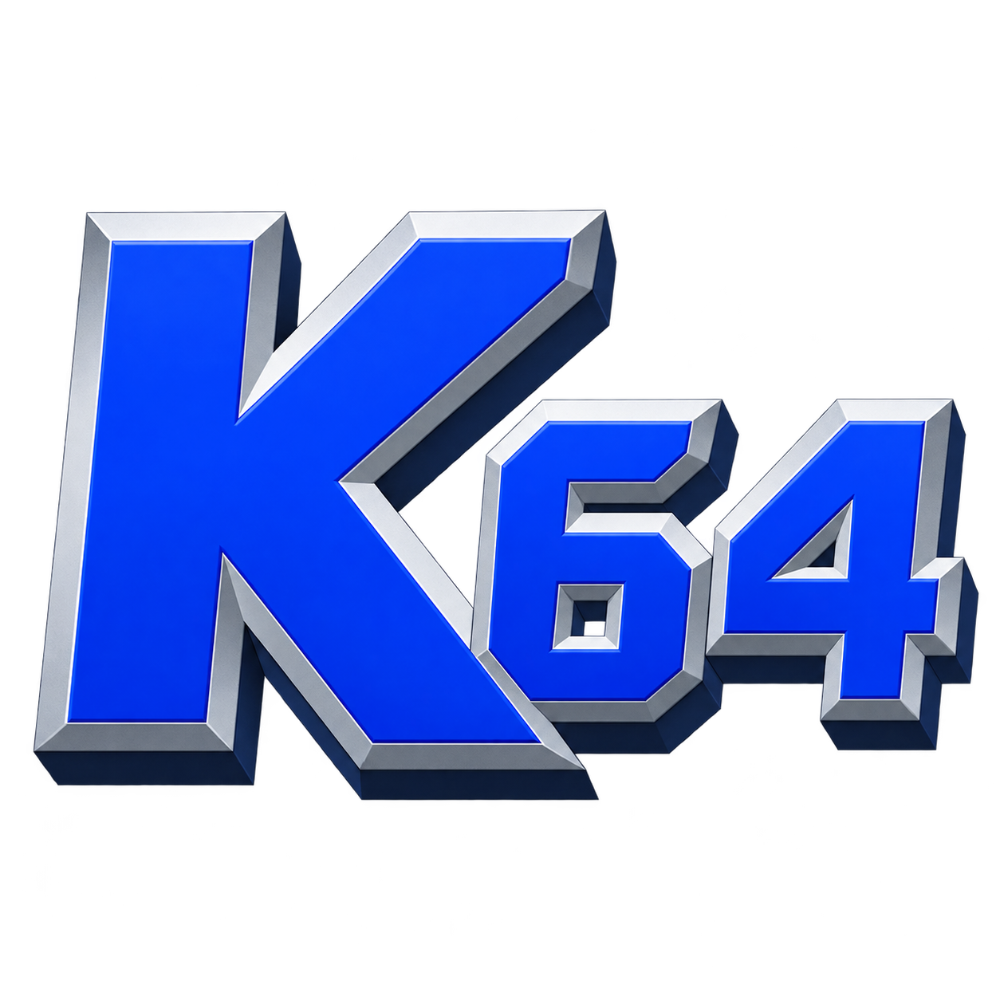

# KernelN64



KernelN64 is a Pure Java Windows Nintendo 64 emulator based on Jario64, with an Eclipse-friendly Java core, GLN64j graphics, experimental Direct3D 11 graphics, and Azimer HLE audio.

This is a **development preview**. Compatibility varies by game; Super Mario 64 has received the most local testing. No game ROMs, firmware ROMs, saves or game assets are included.

## Features

* GLN64j and experimental native Direct3D 11 graphics, with live graphics/audio/input plugin switching.
* HLE audio, configurable fast mode, controller mapping and window settings.
* Savestates with numbered/named slots, file import/export and rewind.
* GameShark cheats, SM64 presets and address mapping for supported SM64 decomp builds with a matching ELF.
* CPU debugger, memory tools and a guest kernel thread monitor with audio handshake diagnostics.
* Recent ROMs and an EXE launcher for external tools.

## Run the portable release

Extract the entire Windows x64 ZIP into a writable folder and run `KernelN64.exe`. Its Java runtime and native libraries stay together in the extracted folder. Use **File > Open ROM** to open your own game image.

External tools can launch a ROM with:

```powershell
.\KernelN64.exe "C:\Games\Example.z64"
.\KernelN64.exe --rom "C:\Games\Example.z64" --state "C:\States\scene.j64state"
```

## Open in Eclipse

Install a **64-bit JDK 21 or newer**. Import this folder as an existing Eclipse project named **KernelN64**, refresh it, and run `kerneln64.Main` or the shared **KernelN64** launch configuration. Use the project folder as the working directory for saves and settings. GLN64j and D3D11 find their bundled native DLLs automatically; no manual library-path setup is required.

## Build the Windows package

Requirements: Windows x64, a JDK 21+, Visual Studio or Build Tools with **Desktop development with C++**, the Windows 10/11 SDK, and the Windows .NET Framework C# compiler.

```powershell
$env:JAVA_HOME = "C:\Path\To\Your\JDK"
.\launcher\Build.ps1
```

Alternatively, pass `-Jdk "C:\Path\To\Your\JDK"`. The build discovers Visual C++ with `vswhere` and writes the portable application to `dist/KernelN64`. It also refreshes Eclipse's compiled classes. The included JOGL/GlueGen dependencies are retained in `Jario64winportable` for compatibility with existing project configuration.

The main application and native renderer sources are included. Testing fixtures and automated testing files are intentionally omitted from this prepared source snapshot.

## Documentation and limitations

* [Source layout](docs/Source-layout.md)
* [SM64 decomp cheat mapping](docs/SM64-decomp-cheats.md)
* [Standalone GameShark firmware support](docs/GameShark-firmware.md)

Direct3D 11 is experimental; some N64 rasterization behavior is approximated. Standalone GameShark support provides firmware menu emulation, not a physical pass-through cartridge. Audio distortion presets are experiments and can destabilize a game; documented approximations are labeled in the preset notes.

## Notices

Read [third-party notices](THIRD-PARTY-NOTICES.md) and [release preparation](docs/Release-preparation.md) before publishing this snapshot. GPL text is retained in `COPYING`, and original copyright/license notices remain in source files. Some inherited files also retain Project64 noncommercial-use terms; this snapshot does not replace or resolve those terms with a blanket license.
